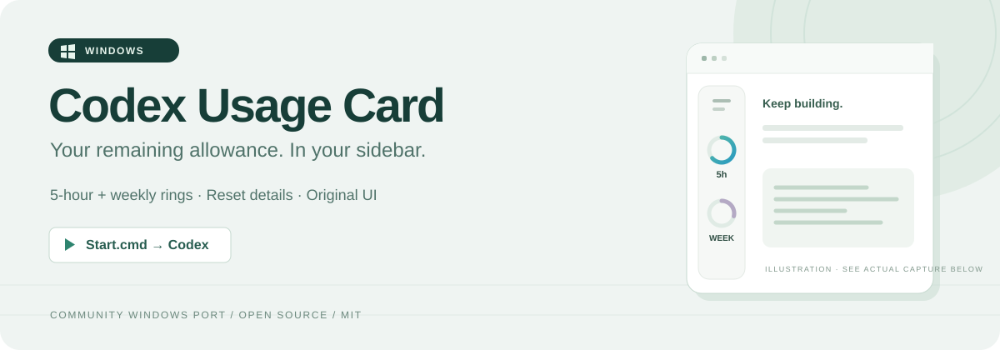
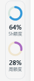
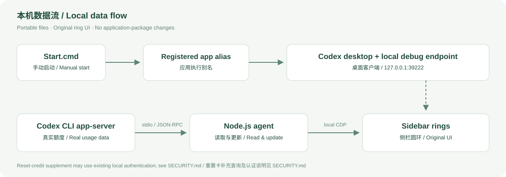

<p align="center">
  
</p>

<h1 align="center">🪟 Codex Usage Card · Windows</h1>

<p align="center">
  <strong>How much allowance is left? Just glance at your sidebar. 👀</strong><br>
  Compact remaining-usage rings inside the Codex desktop app on Windows.
</p>

<p align="center">
  <a href="README.md">简体中文</a> · <a href="README.en.md">English</a> ·
  <a href="#-quick-start">🚀 Quick start</a> · <a href="SECURITY.md">🔐 Security & privacy</a>
</p>

<p align="center">
  
  
  
  
</p>

> 🧩 An **unofficial, experimental community Windows port**, based on [Codex Usage Card](https://github.com/Lorie7813/codex-usage-card) and [SimonTan95's Windows PR](https://github.com/Lorie7813/codex-usage-card/pull/1), with a Microsoft Store launch fix. Not affiliated with or endorsed by OpenAI.

## 🎯 What does this project do?

It puts your Codex account's **remaining usage allowance** in the desktop app's left navigation rail. Rings, percentages, and a tooltip show your available allowance and reset times while you work. 📊

- ⏱️ **5-hour allowance** when the account exposes that usage window.
- 📅 **Weekly allowance** when supported by the available data.
- 🖱️ **Hover details** for reset times and reset credits when available.
- 🎨 **Original appearance**: reuse the upstream rings, colors, single/dual layouts, and tooltip.
- 🌗 **Light and dark themes**, plus keyboard-focus details.
- 🔄 **Real usage updates**: retain upstream 60-second active polling, 5-second connection checks, and quota-update notifications.
- 📦 **Portable folder**: Node.js 24+, no `npm install`, and no changes to the Codex application package.

**The percentages show remaining account allowance, not conversation context usage, a token counter, or billing amounts.** Accounts and APIs determine which data exists; some accounts may show one ring or unavailable data.

## 📸 In action

<table>
  <tr>
    <td align="center" width="180">
      
    </td>
    <td>
      <strong>✅ A real screenshot from the Windows client</strong><br><br>
      🔵 Top: remaining 5-hour allowance<br>
      🟣 Bottom: remaining weekly allowance<br><br>
      64% / 28% were the readings at capture time; values vary by account and time.<br>
      This is a cropped view of the rings. The banner above is an illustration.
    </td>
  </tr>
</table>

## 🚀 Quick start

### 1️⃣ Check requirements

| Requirement | Details |
| --- | --- |
| 🪟 Windows | Intended for Windows 10/11; this revision has been checked on one Windows machine |
| 🛍️ Codex desktop | **Microsoft Store installation**, already signed in |
| 🟢 Node.js | **24 or newer**; `node --version` must work in a terminal |
| 🔗 App execution alias | The client's registered `chatgpt-desktop.exe` alias must be available |

Get Node.js from its [official website](https://nodejs.org/en/download). Compatibility with non-Store installations is not established.

### 2️⃣ Get the files

Use **Code → Download ZIP** above and fully extract it, or clone:

```powershell
git clone https://github.com/zssz666/codex-usage-card-windows.git
cd codex-usage-card-windows
```

### 3️⃣ Start manually

1. 💾 Save your work.
2. 🚪 **Fully quit Codex** through its system-tray menu; closing a window may leave it running.
3. ▶️ Double-click **`Start.cmd`** in the extracted folder.
4. ⏳ Wait for Codex and the rings to load. This usually takes a few seconds; the launcher waits up to 30 seconds for a compatible window.
5. 🎉 Check the left navigation rail. Hover or focus the rings for details.

Equivalent terminal command:

```powershell
node windows.cjs start
```

> 📌 Keep the whole folder together. Do not move `Start.cmd` alone. **The normal Codex icon does not enable this add-on's debugging connection.** The launcher will not automatically restart an active work session.

## 🧰 Status, stop, and removal

| Action | Double-click | Terminal |
| --- | --- | --- |
| ▶️ Start Codex and the rings | `Start.cmd` | `node windows.cjs start` |
| 🔎 Inspect ring status | `Status.cmd` | `node windows.cjs status` |
| ⏹️ Stop monitoring and remove rings | `Stop.cmd` | `node windows.cjs stop` |
| 🩺 Inspect installation paths | — | `node windows.cjs doctor` |
| 🔌 Attach to an existing debug window | — | `node windows.cjs attach` |

A normal visible main window typically reports `placed=true`, `badgeCount=1`, and `stale=false`. `attach` requires an existing compatible local debugging connection; it cannot enable a port on an ordinarily launched window.

🧹 **Removal:** run `Stop.cmd`, fully quit Codex, and reopen it through the original icon to close the debugging port enabled for that launch. Remove any sign-in task or shortcut you configured before deleting the project folder. Stopping the monitor does not close Codex or immediately close its debugging port.

## 🧠 How it works

<p align="center">
  
</p>

1. 🪟 Discover the Store-installed client and its associated CLI.
2. 🔑 Start the client through its registered **app execution alias**, with local debugging arguments.
3. 📡 Read usage through the CLI `app-server` and send updates to the sidebar component.
4. 🧩 Place and update the UI using CDP at `127.0.0.1:39222`.

### 🔧 What does this revision fix?

Executing the EXE inside the Store package directly produced **`spawn EPERM` / Windows error 5** on the checked machine. This revision launches via the registered `chatgpt-desktop.exe` alias. Alias discovery uses `lstat` so the special reparse point is not mistaken for a missing file.

The upstream ring UI and quota protocol are retained. A missing required alias produces an explicit error; the launcher does not silently try other launch methods or change system permissions.

## 🔐 Security & privacy: read before running

- 🏠 **The local debug interface is powerful.** CDP can evaluate JavaScript inside app windows. Loopback binding is not authentication; never forward, proxy, or expose port `39222`.
- 📂 The usage agent does not scan projects, request chat contents, or read the conversation database.
- 🔄 **Reset credits have an additional data path.** If the CLI omits those fields, the inherited Windows code reads `CODEX_HOME/auth.json` (default `~/.codex/auth.json`) and makes an authenticated read-only GET to `https://chatgpt.com/backend-api/wham/rate-limit-reset-credits`.
- 🧪 That endpoint is undocumented and may change. Failures show unavailable, not zero credits. Redirects are rejected and credentials are not logged. This supplemental path currently has no separate switch.
- 📝 Logs and status output may contain local paths, usage, and runtime details. Redact before sharing.
- 🚫 No built-in automatic updater, application-package patching, login-file edits, or system security-policy changes.

See [SECURITY.md](SECURITY.md). These statements are not a security-audit guarantee and do not describe the Codex client's own data handling.

## 🛠️ Troubleshooting

| Symptom | Check |
| --- | --- |
| `node` not found | Install Node.js 24+, reopen the launcher, and check `node --version` |
| Codex is already running | Save work, fully quit through the system tray, and run `Start.cmd` manually |
| `spawn EPERM` | Use this repository's complete files and inspect `launchApp` with `doctor`; do not change WindowsApps permissions |
| Missing execution alias | Check the Store installation and its `chatgpt-desktop.exe` registration; the launcher will not change system settings for you |
| Window opens without rings | Read `windows.log`, then run `Status.cmd`; updates may change debugging or sidebar structure |
| Status returns `fetch failed` | No compatible debugging port is available, or the client/monitor has exited |
| Usage unavailable | Check Codex login and network; the account may not expose that data |
| Rings disappear after a brief disconnect | The current monitor may exit on endpoint failure; inspect the log and restart manually |

## ✅ Validation & limitations

| Area | Evidence |
| --- | --- |
| 🧪 Offline tests | **12 passed**: 6 inherited Windows tests and 6 launch-regression tests |
| 🪟 Machine checked | One Windows installation, Store Codex `26.1027.3384.0`, Node.js `24.11.1` |
| 📊 Actual display | User-provided screenshot confirms dual rings with real readings |
| 🖼️ UI provenance | Upstream ring and tooltip rendering retained; local hover behavior has not received separate full acceptance testing |
| 🧭 Not fully verified | Sign-in startup, account switching, concurrent launches, long-term reconnects, other versions, and different display scales |

⚠️ Experimental software. Internal APIs and navigation structure can change with client updates; future compatibility is not guaranteed.

`autostart.cjs` retains the upstream optional sign-in entry, but **downloading or first running this project does not register startup tasks**. A real reboot/sign-in cycle remains unverified. Interactive `Start.cmd` is not a silent sign-in task.

## 🧑‍💻 Development & tests

```powershell
node --test --test-timeout=60000 windows.test.cjs launch.test.cjs
node windows.cjs doctor
```

No third-party npm dependencies. `agent.cjs` is an upstream generated runtime with attribution retained; the local launch fix lives separately in `windows-launch.cjs`.

```text
├─ Start.cmd / Status.cmd / Stop.cmd  # Manual entry points
├─ windows.cjs                       # Discovery, monitoring, commands
├─ windows-launch.cjs                # Store app execution alias launch
├─ agent.cjs                         # Upstream usage agent and original UI
├─ reset-credits.cjs                 # Supplemental reset-credit query
├─ autostart.cjs                     # Optional, manually configured entry
├─ *.test.cjs                        # Offline tests
└─ docs/images/                      # Banner, actual capture, diagram
```

## 🙏 Credits & license

- 🌱 Original project: [Lorie7813/codex-usage-card](https://github.com/Lorie7813/codex-usage-card).
- 🪟 Windows port: [SimonTan95's PR #1](https://github.com/Lorie7813/codex-usage-card/pull/1), baseline commit `1c5359dc648a99525bb6c169f7149e51d3ce9712`.
- 🔧 This repository: Store app execution alias launch fix, diagnostics, bilingual documentation, and the supplied live screenshot.
- 📜 [MIT licensed](LICENSE), with the original copyright notice preserved. See [third-party notices](THIRD_PARTY_NOTICES.md).

💚 Thanks to the original authors and Windows-port contributor. This is not an official OpenAI product.
