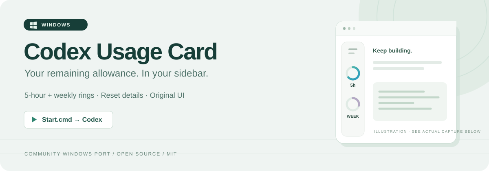
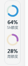
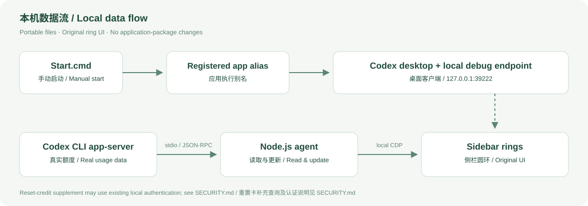

<p align="center">
  
</p>

<h1 align="center">🪟 Codex Usage Card · Windows</h1>

<p align="center">
  <strong>额度还剩多少？抬眼看侧栏就知道。 👀</strong><br>
  为 Windows 版 Codex 桌面客户端添加小巧的剩余额度圆环。
</p>

<p align="center">
  <a href="README.md">简体中文</a> · <a href="README.en.md">English</a> ·
  <a href="#-快速开始">🚀 快速开始</a> · <a href="SECURITY.md">🔐 安全与隐私</a>
</p>

<p align="center">
  
  
  
  
</p>

> 🧩 这是一个**非官方、实验性的社区 Windows 移植版**，基于 [Codex Usage Card](https://github.com/Lorie7813/codex-usage-card) 和 [SimonTan95 的 Windows PR](https://github.com/Lorie7813/codex-usage-card/pull/1)，加入商店版客户端启动修复。与 OpenAI 无官方关联。

## 🎯 这个项目是做什么的？

它会把 Codex 账号的**剩余使用额度**放进客户端左侧导航栏：用圆环、百分比和提示框，让你在工作时就能看到可用额度与重置时间。📊

- ⏱️ **5 小时额度**：支持时显示这个时间窗口的剩余比例。
- 📅 **每周额度**：支持时显示周额度的剩余比例。
- 🖱️ **悬停详情**：查看重置时间，以及数据可用时的重置卡信息。
- 🎨 **保留原版外观**：复用上游圆环、配色、单双环和提示框布局。
- 🌗 **深浅主题**：跟随客户端主题；支持键盘聚焦提示。
- 🔄 **真实额度刷新**：保留上游 60 秒主动轮询、5 秒连接检查和额度更新通知。
- 📦 **便携运行**：Node.js 24+，无需 `npm install`，不修改 Codex 安装包。

**这些百分比是账号剩余额度，不是单次聊天的上下文占用、token 计数或账单金额。** 账号与接口决定可用的数据；部分账号可能显示单环或“暂不可用”。

## 📸 实际效果

<table>
  <tr>
    <td align="center" width="180">
      
    </td>
    <td>
      <strong>✅ Windows 客户端中的真实截图</strong><br><br>
      🔵 上方：5 小时剩余额度<br>
      🟣 下方：每周剩余额度<br><br>
      截图中的 64% / 28% 是当时的读数，实际显示会随账号变化。<br>
      这是圆环区域的局部截图；上方横幅是说明性插图。
    </td>
  </tr>
</table>

## 🚀 快速开始

### 1️⃣ 准备环境

| 需要什么 | 说明 |
| --- | --- |
| 🪟 Windows | 面向 Windows 10/11；当前版本只在一台 Windows 机器上实测 |
| 🛍️ Codex 桌面端 | 已安装并登录的 **Microsoft Store 版本** |
| 🟢 Node.js | **24 或更新版本**，安装后可在终端运行 `node --version` |
| 🔗 应用执行别名 | 客户端注册的 `chatgpt-desktop.exe` 别名必须可用 |

Node.js 可从 [官方网站](https://nodejs.org/en/download) 获取。当前不支持凭此项目声明兼容非商店版安装。

### 2️⃣ 下载代码

点击仓库上方 **Code → Download ZIP**，完整解压；或者：

```powershell
git clone https://github.com/zssz666/codex-usage-card-windows.git
cd codex-usage-card-windows
```

### 3️⃣ 手动启动

1. 💾 保存当前工作。
2. 🚪 从系统托盘菜单**完全退出 Codex**，只关闭窗口可能仍留有后台进程。
3. ▶️ 双击解压目录中的 **`Start.cmd`**。
4. ⏳ 等待客户端打开并加载，通常需要数秒；启动器最多等待 30 秒发现兼容窗口。
5. 🎉 在左侧导航栏查看额度圆环，悬停或键盘聚焦可看详情。

终端等效命令：

```powershell
node windows.cjs start
```

> 📌 请保留整个目录。不要只移动 `Start.cmd`。**普通 Codex 图标不会为这个插件开启调试连接**；本项目也不会自动重启你正在工作的客户端。

## 🧰 查看状态、停止与移除

| 操作 | 双击文件 | 终端命令 |
| --- | --- | --- |
| ▶️ 启动客户端与圆环 | `Start.cmd` | `node windows.cjs start` |
| 🔎 查看圆环状态 | `Status.cmd` | `node windows.cjs status` |
| ⏹️ 停止监控并移除圆环 | `Stop.cmd` | `node windows.cjs stop` |
| 🩺 检查安装与路径 | — | `node windows.cjs doctor` |
| 🔌 连接已有调试窗口 | — | `node windows.cjs attach` |

正常可见主窗口通常报告 `placed=true`、`badgeCount=1`、`stale=false`。`attach` 需要客户端已经带有兼容的本机调试连接，不会替普通启动的窗口补开端口。

🧹 **移除方式：**先运行 `Stop.cmd`，完全退出 Codex，再从原图标打开，即可关闭这次启动的调试端口。若自行配置过登录启动，请先移除对应任务或快捷方式，随后可删除项目目录。停止监控本身不会关闭 Codex，也不会立即关闭调试端口。

## 🧠 它如何工作？

<p align="center">
  
</p>

1. 🪟 Windows 启动器识别商店版客户端和随客户端提供的 CLI。
2. 🔑 通过客户端注册的**应用执行别名**启动，附带本机调试参数。
3. 📡 代理通过 CLI `app-server` 获取额度，并将数值更新到侧栏组件。
4. 🧩 通过 `127.0.0.1:39222` 的 CDP 连接放置和更新界面。

### 🔧 这个版本修复了什么？

直接执行商店包目录中的 EXE，在本次验证环境中会出现 **`spawn EPERM` / Windows 错误码 5**。本版改用已注册的 `chatgpt-desktop.exe` 别名启动；别名检查使用 `lstat`，避免特殊重解析点被错误判断为不存在。

这是对 Windows 启动方式的修复；圆环 UI 与上游额度协议保留。缺少所需别名时会明确报错，不自动改走其他启动路径、不调整系统权限。

## 🔐 安全与隐私：安装前请读

- 🏠 **本机调试接口权限较高。** CDP 能执行窗口中的 JavaScript，绑定本机不等于有身份认证；不要转发、代理或开放 `39222` 端口。
- 📂 当前额度代理不扫描工程，不请求聊天内容，也不读取对话数据库。
- 🔄 **重置卡有额外取数路径。** 若 CLI 未返回重置卡字段，上游 Windows 代码会读取 `CODEX_HOME/auth.json`（默认 `~/.codex/auth.json`），向 `https://chatgpt.com/backend-api/wham/rate-limit-reset-credits` 发起带认证的只读 GET。
- 🧪 该重置卡端点未公开，可能变化；失败显示“暂不可用”，不会显示为零张卡。代码拒绝重定向，不将凭据记录到日志；这个补充路径当前没有独立开关。
- 📝 日志和 `status` 输出可能包含本机路径、额度与运行信息，公开前应脱敏。
- 🚫 不内置自动更新，不修改客户端安装包或登录文件，不更改系统安全策略。

完整说明见 [SECURITY.md](SECURITY.md)。这些说明不构成安全审计保证，也不涵盖 Codex 客户端自身的数据处理。

## 🛠️ 常见问题

| 现象 | 检查方法 |
| --- | --- |
| `node` 找不到 | 安装 Node.js 24+，重新打开启动入口，检查 `node --version` |
| 提示 Codex 已运行 | 保存工作，从系统托盘完全退出，然后手动运行 `Start.cmd` |
| `spawn EPERM` | 确认使用本仓库的完整代码，并运行 `doctor` 检查 `launchApp`；不要去修改 WindowsApps 权限 |
| 提示应用执行别名缺失 | 确认商店版客户端及其 `chatgpt-desktop.exe` 注册状态；启动器不会替你更改系统设置 |
| 有窗口但没有圆环 | 查看 `windows.log`，再运行 `Status.cmd`；客户端更新可能改变调试接口或侧栏结构 |
| 状态查询 `fetch failed` | 当前未提供兼容的调试端口，或客户端/监控已退出 |
| 额度“暂不可用” | 检查 Codex 登录和网络；账号可能没有相应数据 |
| 短暂断连后圆环消失 | 当前监控可能因端点失败退出，需手动检查日志并重新启动 |

## ✅ 验证范围与限制

| 项目 | 当前证据 |
| --- | --- |
| 🧪 离线测试 | **12 项通过**：原 Windows PR 的 6 项测试，加本地启动修复的 6 项回归测试 |
| 🪟 实机环境 | 一台 Windows 机器，商店版 Codex `26.1027.3384.0`、Node.js `24.11.1` |
| 📊 真实显示 | 用户实测截图确认双环和数值显示；截图见上方 |
| 🖼️ 界面来源 | 保留上游圆环与提示框渲染代码；本机悬停交互未另行完整验收 |
| 🧭 尚未完整验证 | 登录后自动启动、账号切换、并发启动、长期重连、跨版本及不同缩放比例 |

⚠️ 这是实验性版本。内部接口和导航栏结构可能随客户端更新变化，不能保证未来版本持续兼容。

`autostart.cjs` 保留了上游可选登录入口，但**下载或首次运行不会注册自启动**。真正重启登录后的效果尚未验证，普通 `Start.cmd` 也不适合作为静默登录任务。

## 🧑‍💻 开发与测试

```powershell
node --test --test-timeout=60000 windows.test.cjs launch.test.cjs
node windows.cjs doctor
```

无需第三方 npm 依赖。`agent.cjs` 是保留归属信息的上游生成运行文件；本地启动修复独立放在 `windows-launch.cjs` 中。

```text
├─ Start.cmd / Status.cmd / Stop.cmd  # 手动操作入口
├─ windows.cjs                       # 发现、监控、管理命令
├─ windows-launch.cjs                # 商店版应用执行别名启动
├─ agent.cjs                         # 上游额度代理与原版界面
├─ reset-credits.cjs                 # 重置卡补充查询
├─ autostart.cjs                     # 可选登录入口，需自行配置
├─ *.test.cjs                        # 离线测试
└─ docs/images/                      # 横幅、实测截图和原理图
```

## 🙏 来源、致谢与许可

- 🌱 原项目：[Lorie7813/codex-usage-card](https://github.com/Lorie7813/codex-usage-card)。
- 🪟 Windows 移植：[SimonTan95 的 PR #1](https://github.com/Lorie7813/codex-usage-card/pull/1)，基线提交 `1c5359dc648a99525bb6c169f7149e51d3ce9712`。
- 🔧 本仓库：Windows 应用执行别名启动修复、错误诊断、中英双语文档与实测截图。
- 📜 遵循 [MIT 许可证](LICENSE)，保留原始版权声明；详见 [第三方来源说明](THIRD_PARTY_NOTICES.md)。

💚 感谢原作者和 Windows 移植贡献者。本项目不是 OpenAI 官方产品。
